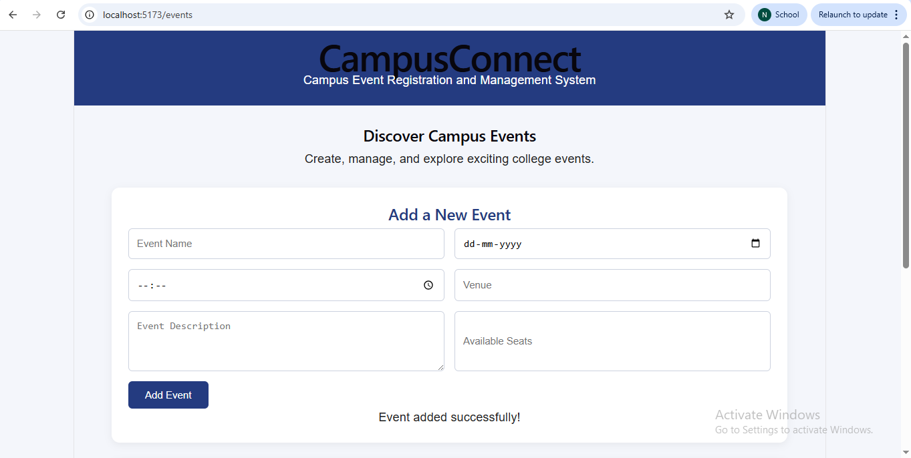
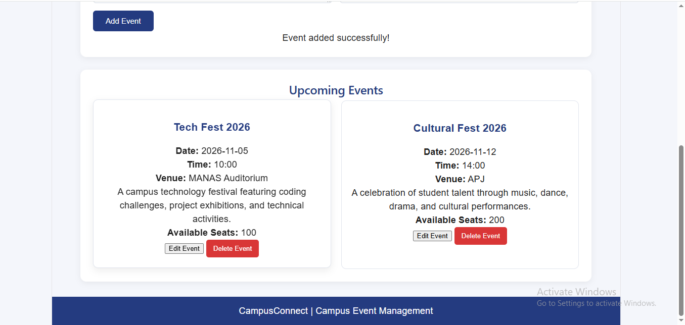
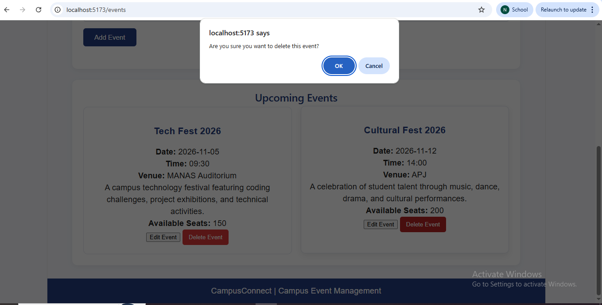
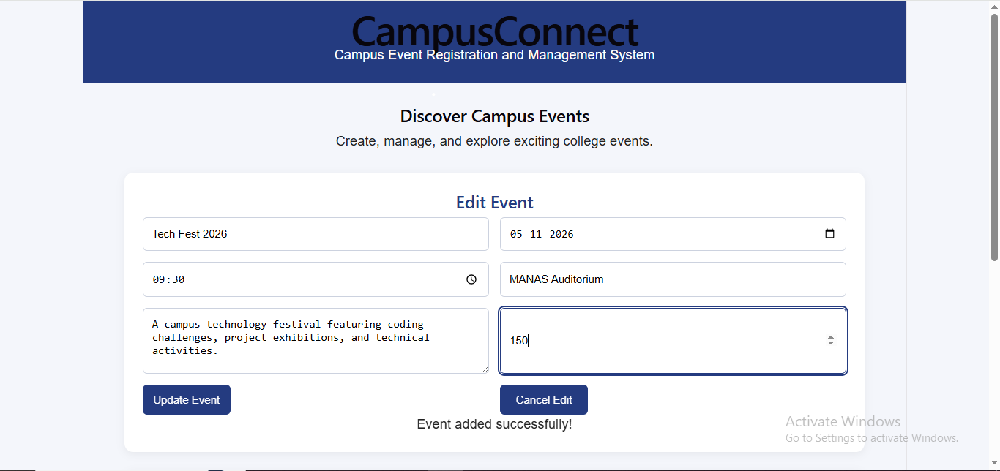

# CampusConnect – Campus Event Registration and Management System

## Overview
CampusConnect is a Java Full Stack mini project developed to manage college events. The application allows users to create, view, update, and delete event details through a simple web interface.

## Objectives
- Implement CRUD operations for campus events.
- Develop a user-friendly frontend using React.js.
- Create REST APIs using Java Spring Boot.
- Store event information in a MySQL database.

## Technologies Used
- **Frontend:** React.js, JavaScript, CSS
- **Backend:** Java, Spring Boot
- **Database:** MySQL
- **API Integration:** Axios
- **Build Tool:** Vite

## Features
1. Add new campus events.
2. View all events.
3. Update existing event details.
4. Delete events.
5. Display event name, date, time, venue, description, and available seats.

## Frontend Screenshots

### 3. Delete Event

### 4. Edit Event

## Project Structure
- `src/App.jsx` – Main React application
- `src/App.css` – Application styling
- `src/api.js` – Backend API connection
- `src/main.jsx` – React entry point
- `public/` – Public assets

## Backend
The backend is developed separately using Java Spring Boot and MySQL.

## Conclusion
This project demonstrates the practical implementation of CRUD operations and frontend-backend integration using React.js, Spring Boot, REST APIs, and MySQL.
